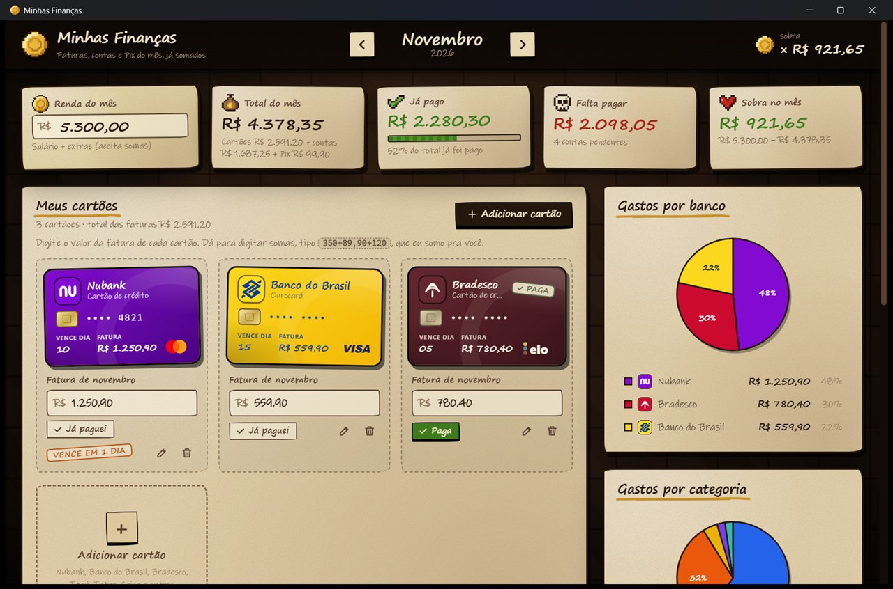
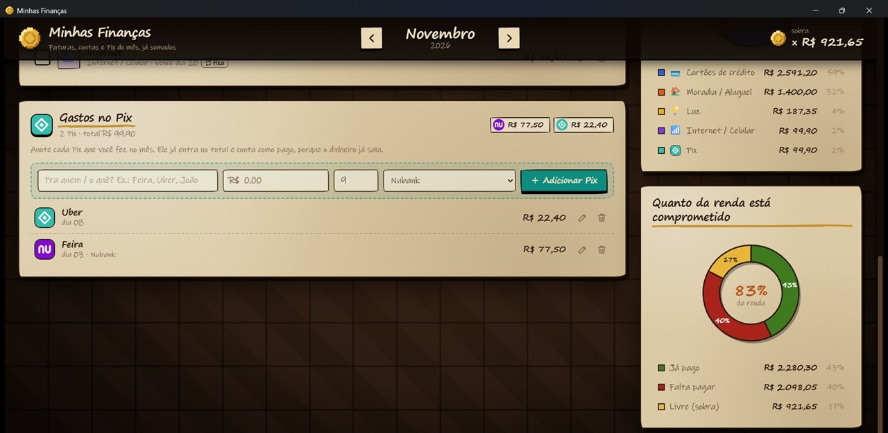

<p align="center">
  
</p>

<h1 align="center">Money Go Power</h1>

<p align="center">
  <b>Minhas Finanças</b>: soma as faturas dos cartões, as contas e os Pix do mês,<br>
  mostra quanto já foi pago, quanto falta e quanto sobra da renda, com gráficos de pizza.<br>
  Feito em <b>Rust + Tauri</b>, com visual de porão roguelike em pixel art.
</p>

<p align="center">
  
</p>

<p align="center">
  
</p>

## Baixar

<p align="center">
  <a href="https://github.com/matheusbwv/Money-Go-Power/releases/latest/download/MinhasFinancas.exe"><b>⬇ Baixar o MinhasFinancas.exe</b></a>
  · <a href="https://github.com/matheusbwv/Money-Go-Power/releases">todas as versões</a>
</p>

Baixe o `MinhasFinancas.exe`, coloque onde preferir e dê dois cliques: não precisa instalar.
Funciona no Windows 10 e 11 (64 bits); ele usa o
[WebView2](https://developer.microsoft.com/microsoft-edge/webview2/) da Microsoft, que já
vem no Windows 11 e chega pelas atualizações do Windows 10.

Como o `.exe` não tem assinatura digital paga, o Windows pode mostrar "O Windows protegeu
o computador" na primeira vez: clique em **Mais informações** e em **Executar assim mesmo**.

## Como usar

1. **Renda do mês** (no topo): digite seu salário + extras. Pode digitar somas: `3500+800`.
2. **Meus cartões**: já vem com **Nubank**, **Banco do Brasil** e **Bradesco**. Digite o
   valor da fatura de cada um e aperte `Enter` ou `Tab`. Também aceita somas:
   `350+89,90+120` (o programa soma para você).
3. **+ Adicionar cartão**: escolha entre Nubank, Banco do Brasil, Bradesco, Itaú,
   Santander, Caixa, Inter, C6 Bank, PicPay, Mercado Pago, Sicoob, Sicredi, BTG, XP,
   Banrisul ou **Outro banco** (você escolhe o nome e a cor). Dá para escolher a bandeira
   (Visa, Mastercard, Elo, Amex, Hipercard), o final do cartão e o dia do vencimento.
4. **Outras contas do mês**: aluguel, luz, água, internet... Marque **Conta fixa** para
   ela aparecer sozinha nos próximos meses.
5. **Gastos no Pix**: anote cada Pix do mês (pra quem, valor, dia e, se quiser, de qual
   banco saiu) e aperte `Enter`. O Pix entra no total e já conta como pago, porque o
   dinheiro já saiu. No topo do painel aparece quanto saiu no Pix de cada banco.
6. Clique em **Já paguei** (cartões) ou no quadradinho ✓ (contas) quando pagar.
7. Use as setas no topo (ou `Alt + ←/→`) para trocar de mês. Um mês novo já começa com a
   renda e as contas fixas do mês anterior; as faturas e os Pix começam zerados.

### Os resumos

| Quadro | O que mostra |
| --- | --- |
| 🪙 Renda do mês | Salário + extras |
| 💰 Total do mês | Soma de todas as faturas + contas + Pix |
| ✔️ Já pago / 💀 Falta pagar | Separado pelo que você marcou como pago (Pix sempre conta como pago) |
| ❤️ Sobra no mês | Renda − total do mês (o coração parte se faltar dinheiro) |

O contador de moedas no canto superior direito também mostra a sobra do mês.

### Os gráficos de pizza

- **Gastos por banco**: faturas dos cartões nas cores de cada banco (roxo Nubank, amarelo BB, vermelho Bradesco...).
- **Gastos por categoria**: cartões, Pix, moradia, mercado, luz, etc.
- **Quanto da renda está comprometido**: já pago, falta pagar e o que sobra livre.

Os cartões e as contas que vencem em até 5 dias ganham um carimbo laranja; os atrasados, vermelho.

## Onde ficam os dados

Só no seu computador, em
`%APPDATA%\com.matheus.minhasfinancas\financas.json`. Cada pessoa que usa o programa tem o
seu próprio arquivo, e nada é enviado para a internet. O arquivo é gravado a cada
alteração, de forma segura (arquivo temporário + troca). Para fazer backup, é só copiar
esse arquivo. Para atualizar para uma versão nova, é só trocar o `.exe`: os dados
continuam no mesmo lugar.

## Como o projeto é feito

- **Rust + [Tauri 2](https://tauri.app)**: o Rust faz todos os cálculos (em centavos, sem
  erro de arredondamento), entende os valores digitados (`1.234,56`, `100+49,90`...),
  valida tudo e salva o arquivo de dados.
- **HTML + CSS + JavaScript** na interface (pasta `ui/`), com os gráficos de pizza, os
  emblemas dos bancos e a pixel art desenhados em SVG, sem depender de internet.

```
src/main.rs                  janela, comandos chamados pela interface e salvamento
src/dados.rs                 regras, cálculos, leitura de valores e testes
ui/index.html                estrutura da tela
ui/style.css                 visual (tema porão: pedra, papel e tinta)
ui/app.js                    comportamento da tela
ui/bancos.js                 bancos, cores, emblemas e bandeiras de cartão
ui/graficos.js               gráficos de pizza
ui/pixel.js                  pixel art (moeda, coração, caveira e os itens das categorias)
ferramentas/gerar_imagens.js gera o ícone e a moeda do README a partir da pixel art
icons/                       ícone do programa
docs/                        imagens do README
```

Sobre o visual: o tema é **inspirado** no clima de jogos roguelike de porão (pedra escura,
papel rabiscado, pixel art). Cada categoria de conta tem seu "item" em pixel art: casinha
(moradia), lâmpada (luz), gota (água), sinal (internet), maçã (mercado), carrinho
(transporte), cápsula (saúde), livro (educação), dado (lazer), TV (assinaturas), baú
(empréstimo), caixa (outros) e cartão (cartões de crédito). Toda a arte é original, feita para este projeto; não usa
imagens, fontes ou personagens de nenhum jogo. As letras usam as fontes *Ink Free* e
*Segoe Print*, que já vêm no Windows. Os emblemas dos bancos são desenhos em SVG feitos
só para identificar cada cartão no programa; as marcas pertencem aos respectivos bancos.

## Compilar

Precisa do [Rust](https://rustup.rs) e do Visual Studio Build Tools com C++.

```powershell
powershell -ExecutionPolicy Bypass -File .\compilar.ps1
```

O script roda os testes, compila e copia o `MinhasFinancas.exe` para a pasta do projeto.
Os arquivos temporários da compilação vão para a pasta `target/`. Se o projeto estiver
dentro do OneDrive, é melhor mandar essa pasta para fora dele (o OneDrive costuma travar
esses arquivos), criando um `.cargo/config.toml` local, que não vai para o Git:

```toml
[build]
target-dir = "C:/MinhasFinancas-build"
```

Para gerar de novo o ícone e a moeda do README depois de mexer na pixel art:

```powershell
node ferramentas/gerar_imagens.js
```

## Publicar uma versão nova

As versões são publicadas sozinhas pelo GitHub Actions
([`.github/workflows/release.yml`](.github/workflows/release.yml)): ao enviar uma tag
`v...`, o GitHub roda os testes, compila o `.exe` no Windows e cria a release com ele.

1. Troque a versão em `Cargo.toml` e em `tauri.conf.json` (ex.: `1.1.0`) e rode o
   `compilar.ps1`, que também atualiza o `Cargo.lock`.
2. Anote as mudanças no [`CHANGELOG.md`](CHANGELOG.md) e atualize o texto da release em
   [`.github/notas-da-versao.md`](.github/notas-da-versao.md).
3. Faça o commit e envie a tag:

```powershell
git tag v1.1.0
git push origin main v1.1.0
```

Também dá para publicar sem tag: na aba **Actions** do GitHub, abra **Release** e clique em
**Run workflow**. Ele usa a versão que está no `Cargo.toml`.
